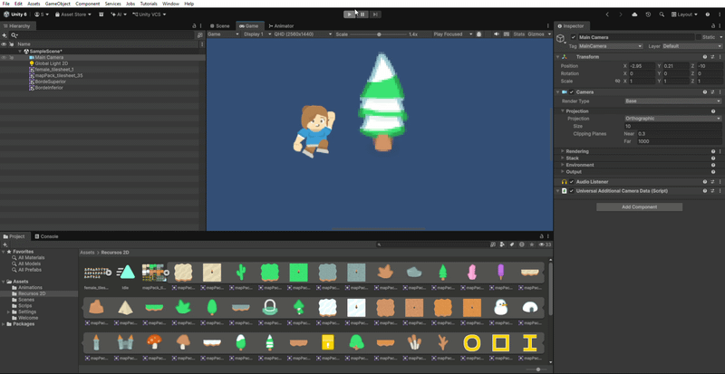

# Práctica 10: Introducción a Unity 2D - Sprites

## Objetivo

El objetivo de esta práctica es aprender a trabajar con sprites en Unity 2D, crear animaciones, controlar el movimiento de un personaje mediante el teclado y experimentar con la configuración de la cámara.

## Apartado 1. Atlas de sprites

Se importaron los recursos gráficos y se configuró el Sprite Mode como Multiple. Mediante Sprite Editor se dividió el atlas en diferentes sprites y se añadió un personaje a la escena.

## Apartado 2. Creación de animaciones

Se crearon las animaciones Walk Down e Idle y se generó un Animator Controller para controlar los estados del personaje.

Se configuraron transiciones entre los estados utilizando parámetros del Animator, como el booleano `isWalking` y el Trigger `changeAnimation`.

## Apartado 3. Movimiento del personaje

Se creó el script `MovimientoJugador.cs` para controlar el movimiento del personaje mediante código.

## Apartado 4. Control con el teclado

Se utilizó el teclado para controlar el movimiento horizontal del personaje mediante las flechas izquierda y derecha.

## Apartado 5. Movimiento con Input.GetAxis

Se utilizó `Input.GetAxis("Horizontal")` para obtener la entrada horizontal del teclado.

También se utilizó `Time.deltaTime` para conseguir un movimiento independiente de la velocidad de fotogramas.

## Apartado 6. Orientación del personaje

Se utilizó el componente SpriteRenderer y la propiedad `flipX` para cambiar la orientación del personaje dependiendo de la dirección del movimiento.

## Apartado 7. Cambio de animación por distancia

Se creó el script `CambiarAnimacionDistancia.cs` para calcular la distancia recorrida desde la posición inicial.

Cuando el personaje alcanza la distancia establecida, se activa un Trigger del Animator para cambiar de animación.

## Apartado 8. Pixels Per Unit (PPU)

Se experimentó con diferentes valores de Pixels Per Unit: 16, 32, 64 y 100.

Se comprobó que modificar el PPU cambia el tamaño del sprite dentro del mundo de Unity, aunque la imagen mantiene sus píxeles originales.

Finalmente, se eligió un valor de 64 PPU para el personaje.

## Apartado 9. Comparación de sprites

Se añadió un segundo sprite a la escena para comparar sus dimensiones con las del personaje.

Se modificó su escala y se configuraron los valores Filter Mode en Point (no filter) y Compression en None para evitar el desenfoque de los píxeles.

## Apartado 10. Cámara ortográfica

Se configuró la cámara en modo Orthographic y se experimentó con diferentes valores de Size y resoluciones.

Se comprobó que:
- El valor Size modifica el zoom de la cámara.
- La altura visible depende del doble del valor Size.
- La anchura visible cambia según la proporción de la pantalla.
- Los jugadores pueden ver diferentes cantidades de escenario dependiendo de la resolución de su monitor.

## Scripts utilizados

- `MovimientoJugador.cs`
- `CambiarAnimacionDistancia.cs`

## Resultado

En esta práctica se aprendió a importar y configurar sprites, crear animaciones, programar el movimiento de un personaje, utilizar el Animator y experimentar con el PPU y la cámara ortográfica.

## GIF de ejecución

